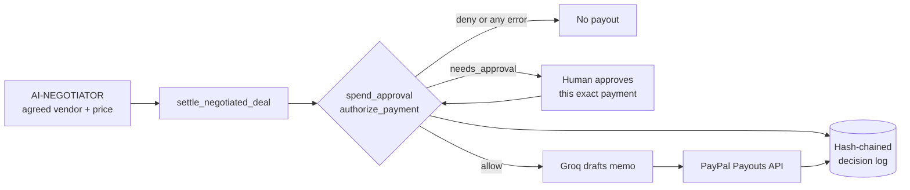

<div align="center">

# negotiator-payments

### Your AI agent closed the deal. It still cannot pay a cent outside your rules.

An AI agent that negotiates a price and then pays the vendor is an agent holding your wallet. One wrong vendor email, one runaway loop, one deal agreed at ten times the budget, and the money is gone before anyone looks. negotiator-payments settles negotiated deals through PayPal Payouts, and puts a spending check in front of every payout: a per-payment cap, a 24-hour cap, a vendor allowlist tied to the PayPal email on file, and a human approval step for anything above a threshold. If the check cannot run, nothing is paid.

[](https://ainegotiator.digital)
[](https://github.com/jayblast-spec/negotiator-payments)


</div>

## What It Does

[AI-NEGOTIATOR](https://ainegotiator.digital) ranks vendor offers and drafts the negotiation, then stops at a recommendation: a person still has to go and pay. This repo is the settlement step. `settle_negotiated_deal()` takes the agreed vendor, PayPal email, purchase and price, and first asks `spend_approval.authorize_payment()` whether this exact payment may go out. The answer is `allow`, `deny` or `needs_approval`. Only `allow` continues: Groq (`openai/gpt-oss-20b`) drafts a one-sentence payout memo, and the PayPal Payouts API sends the money. A denied payment never reaches PayPal, not even for an access token. A held payment waits until a human approves that specific payment, and the approval is good for one payout only. Every decision, approval and payout result is appended to a hash-chained log, so a changed or deleted record is detectable.

The model writes the memo and nothing else. The amount and the recipient come from the approved payment, and the request is compared with the approval once more before it is sent.

## How It Works

- **`spend_approval.py`** `authorize_payment()` runs the check and never raises: any exception inside it becomes a `deny` with `failed_closed: true`. Order of rules: (1) a deal with a payout already on record is refused; (2) hard rules from `spend_policy.json`: policy currency, vendor allowlist (vendor name and the PayPal email on file must both match, which catches a swapped payee), per-payment cap, rolling 24-hour cap; (3) the approval rule from the active backend.
- **Local backend (default, no key needed)**: amounts above `approval_threshold` return `needs_approval` with a `pending_id`. A person runs `python spend_approval.py approve <pending_id>`; the next call for the same payment is allowed once. Requests expire after `approval_ttl_seconds` (15 minutes by default), and so does an unused approval.
- **Aegis backend (when `AEGIS_AGENT_KEY` is set)**: after the local hard rules pass, the payment is sent to `POST /api/enforce` on [aegistrust.digital](https://aegistrust.digital) with the agent's key. `200` is allow, `202` is a hold for the account owner, `403` is deny. A held payment is polled at `GET /api/actions/:id`; once the owner approves, the single-use approval token is sent back with the identical request to release it. The agent key cannot approve its own payments; that takes the owner's key, which this code never reads. If Aegis is unreachable or answers anything undocumented, the payment is denied. The code does not drop back to the local approval rule in that case.
- **`DecisionLog` in `spend_approval.py`**: append-only JSONL. Each record stores the previous record's SHA-256 and its own hash over the previous hash plus its canonical body. `python spend_approval.py verify` walks the chain. A log that does not verify also causes every new check to deny, because the 24-hour total can no longer be trusted.
- **`settle_deal.py`** `settle_negotiated_deal()` calls the check, then `_draft_payout_memo()` (Groq; a plain template is used if `GROQ_API_KEY` is unset or the call fails), then `create_payout()`, and records the outcome as `sent`, `failed` (PayPal refused it, nothing was created) or `unknown` (no definite answer).
- **`paypal_client.py`** `_get_access_token()` does the OAuth2 client-credentials exchange at `/v1/oauth2/token`; `create_payout()` posts to `/v1/payments/payouts`. The `sender_batch_id` is derived from the approved payment and reused on every retry, in the same process or a later run, following PayPal's guidance to retry a failed request with the same `sender_batch_id`. Timeouts and `5xx` are retried up to three times; `4xx` is not retried. A `4xx` that arrives after an attempt with no definite answer is recorded as `unknown`, not `failed`, because it may be PayPal rejecting a duplicate of a batch that did go through. The client refuses any host that is not the PayPal sandbox unless `PAYPAL_ALLOW_LIVE=1` is set.
- **`demo.py`** runs seven steps end to end against a temporary policy and log: a small allowed deal; a deal over the cap; a payee swap; a held deal that a human approves, followed by an attempt to settle it a second time; a deal that would break the daily cap; a check that cannot run; and a tamper test on the log.



## Run It

Python 3.10 or newer (developed and tested on 3.12).

```bash
pip install -r requirements-dev.txt
python demo.py            # full flow as a dry run: no keys needed, nothing sent to PayPal
python -m pytest          # 96 tests, httpx mocked, no network
```

With `PAYPAL_CLIENT_ID` unset, `demo.py` prints `DRY RUN` at the top, makes every decision for real, shows the exact request body it would post to PayPal, and sends nothing.

To send real sandbox payouts, copy `.env.example` to `.env` and fill in:

| Variable | What it is |
|---|---|
| `PAYPAL_CLIENT_ID`, `PAYPAL_CLIENT_SECRET` | A sandbox REST app from the [PayPal Developer Dashboard](https://developer.paypal.com/dashboard/applications/sandbox), owned by a sandbox business account with Payouts enabled and enough sandbox balance to cover the payouts ($292.50 for one demo run). See PayPal's [Payouts integration guide](https://developer.paypal.com/docs/payouts/standard/integrate-api/). |
| `DEMO_VENDOR_PAYPAL_EMAIL` | The email of a sandbox personal account that receives the payout. |
| `GROQ_API_KEY` | Optional. Without it the memo is a template sentence. |
| `AEGIS_AGENT_KEY` | Optional. An Aegis agent key (`aeg_agt_...`) switches the approval rule to Aegis. The matching Aegis policy for the demo is a $500 per-action cap, a $600 window cap, a $100 approval threshold and the `payments` scope. |

```bash
python demo.py                      # now sends the two allowed payouts to the sandbox
python demo.py --manual-approval    # you approve the held payment in a second terminal
python spend_approval.py pending    # payments waiting for a person
python spend_approval.py approve <pending_id> --by "Your Name"
python spend_approval.py verify     # check the decision log's hash chain
```

Edit `spend_policy.json` to change the caps, the approval threshold and the vendor allowlist.

## What Has And Has Not Been Run

Run on this branch (2026-10-13):

- `python -m pytest`: 96 tests pass. They replace `httpx` with a scripted fake, so they prove request shapes and control flow, not PayPal's or Aegis's real behaviour.
- `python demo.py` as a dry run, end to end, with zero requests to PayPal.
- The Groq memo call, with a real key, during that dry run. It returned memos.
- Unauthenticated requests to `https://aegistrust.digital/api/enforce` and to the PayPal sandbox API, which returned `401` as expected.

Not run:

- **No authenticated request has been sent to the PayPal sandbox.** The token exchange and the Payouts call are written from PayPal's documentation and have not been exercised with credentials. No sandbox payout has been made. In particular, how PayPal answers a repeated `sender_batch_id` has not been observed.
- The Aegis backend has not been run with a real agent key. The JSON shape read from `GET /api/actions/:id` (`status`, `approvalToken`) is taken from the prose of the Aegis API reference.
- Nothing in this repo is wired into AI-NEGOTIATOR's deployed app. `settle_negotiated_deal()` takes the agreed terms as arguments.

## Limits

- The local approval step is a separate step, not a separate privilege: anyone who can write the log file can approve. With the Aegis backend the approval needs the owner's key, which the agent does not hold.
- The log is tamper-evident, not tamper-proof. Someone who can rewrite the whole file can rebuild the chain, and trimming the newest records is only detectable if the head hash (printed by `verify` and by each approval) was noted elsewhere.
- The check is a checkpoint in this code path. Code that calls `paypal_client.create_payout()` directly skips it.
- The log file is not safe for concurrent writers.
- Aegis costs are in US dollars, so the Aegis backend refuses non-USD payouts. A payout that fails at PayPal after Aegis allowed it stays counted in Aegis's spending window.

## Live

There is no hosted demo for this repo: it is a library and a command-line demo, run with the instructions above. The negotiation product it settles for is live at [ainegotiator.digital](https://ainegotiator.digital).

## Tech Stack

| Layer | Technology |
|---|---|
| Payments | PayPal REST API: OAuth2 client credentials, Payouts (`/v1/payments/payouts`), sandbox |
| AI | Groq, `openai/gpt-oss-20b`, drafts the payout memo |
| Spend control | `spend_approval.py`: local policy file, optional [Aegis](https://aegistrust.digital) enforcement API |
| Audit | Hash-chained JSONL decision log (SHA-256) |
| HTTP | `httpx` |
| Tests | `pytest`, `httpx` replaced by a scripted fake |
| Language | Python 3.10+ |

## License

Apache 2.0. See [LICENSE](./LICENSE).

<div align="center">


</div>
